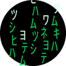

<p align="center">
  
</p>

<h1 align="center">RW4 - CMatrix</h1>

<p align="center">
  
  
  
  
</p>

<p align="center">Klasik <b>CMatrix</b> ("matrix dijital yağmuru") klonu — Redmi Watch 4'ün gerçek siyah AMOLED ekranında.</p>
<p align="center">Tek ekran, kolonlar hâlinde düşen yeşil glifler, saat yok, tarih yok, izin yok.</p>

<p align="center">Bu cihazda bir üçüncü taraf Vela hızlı uygulamasının neler yapıp yapamayacağını haritalayan platform PoC'si olan <a href="https://github.com/hyperpostulate/rw4-poc"><b>rw4-poc</b></a> şablonu üzerine inşa edilmiş minimal bir Xiaomi Vela JS hızlı uygulaması (<code>.rpk</code>).</p>

<p align="center">İlham: Chris Allegretta'nın <b>cmatrix</b>'i (güncel kaynak: <a href="https://github.com/abishekvashok/cmatrix">github.com/abishekvashok/cmatrix</a>).</p>

<p align="center">English version: <a href="README.md">README.md</a></p>

* * *

## İçindekiler

- [Bu nedir](#bu-nedir)
- [Ne gösterir](#ne-gösterir)
- [Saate Kurulum](#saate-kurulum)
- [Derleme ve Çalıştırma](#derleme-ve-çalıştırma)
- [Proje Yapısı](#proje-yapısı)
- [Cihaz üstü bulgular](#cihaz-üstü-bulgular)
- [Sınırlamalar](#sınırlamalar)
- [Lisans](#lisans)
- [Geliştirici](#geliştirici)
- [Katkıda Bulunma](#katkıda-bulunma)

* * *

## Bu nedir

Tek bir işi iyi yapan, bilinçli olarak çok küçük bir uygulama: cmatrix'in düşen karakter yağmurunu Redmi Watch 4'te yeniden yaratır. Saf görsel bir oyuncaktır — saat kadranı, sensör girdisi, ağ veya izin isteği yoktur. Arka planda aynı zamanda bir üçüncü taraf Vela hızlı uygulamasının bu cihazda neler yapabildiğinin çalışan bir gösterimidir.

Şablonun üzerinde kendi uygulamanızı geliştirmek için kaynak projedeki kılavuza bkz.: **[rw4-poc → docs/developing.md](https://github.com/hyperpostulate/rw4-poc/blob/main/docs/developing.md)**.

## Ne gösterir

Tek ekran — gerçek siyah, iki yeşil tonu — sabit bir ızgarayla kaplanır: **16 kolon × 17 satır = 272 hücre** (her biri 24×26 px). Her kolon bağımsız bir glif izidir:

| Özellik | Davranış |
| :-- | :-- |
| **Hız** | Tick başına 0.2–0.4 hücre; her kolonda kesirli biriktirici |
| **İz (trail)** | 6–14 hücre; başta parlak, kuyruğa doğru solar |
| **Yeniden başlama** | Ekrandan çıkan kolon 0–25 tick bekler, sonra yeniden başlar |
| **Mutasyon** | Her tick'te aktif kolonun görünür bir glifini %5 olasılıkla değiştirir (cmatrix'in karakter değiştirme efekti) |
| **Glifler** | %70 halfwidth katakana / %30 Latin harfleri, rakamlar ve semboller |

İki parlaklık tonu kullanılır: beyazımsı yeşil kafa `(208,255,224)` ve gövde yeşili `(0,200,83)`. Animasyon 500 ms'de bir tick'ler; cihazda ekran yaklaşık 0,8 saniyede bir ilerler (bu ızgara için ölçülen donanım tabanı — bkz. [Sınırlamalar](#sınırlamalar)).

Hiçbir izin istenmez: uygulama yalnızca bir JS zamanlayıcısı kullanır.

* * *

## Saate Kurulum

`.rpk` dosyası, Android telefonda yüklü **[Notify for Xiaomi](https://play.google.com/store/apps/details?id=com.mc.xiaomi1)** uygulaması (Google Play adı "Notify for Xiaomi/Mi Band 8-10", paket `com.mc.xiaomi1`, geliştirici OneZeroBit) ile Bluetooth üzerinden saate kurulur. Redmi Watch 4, uygulamanın resmî uyumluluk listesinde yer alır; uygulamanın resmî sitesi özel VelaJS (`.rpk`) uygulamalarının bu yolla kurulmasını belgeler.

> **Doğrulama durumu:** gerçek bir Redmi Watch 4 üzerinde doğrulandı — uygulama bu yöntemle sorunsuz kurulup çalışıyor.

### Ön koşullar

- **Android telefon** (iOS ile `.rpk` kurulamaz).
- Google Play'den kurulmuş **Notify for Xiaomi**.
- Saatin Notify ile eşlenmiş olması: uygulamadaki kurulum sihirbazı eşleme (auth) anahtarını Xiaomi hesabınız üzerinden alır; Mi Fitness'in kurulu kalması zorunlu değildir.
- Saatin Bluetooth bağlantısını aynı anda tek uygulama tutabilir. Mi Fitness kuruluysa durdurun, "Yakındaki cihazlar" iznini kaldırın ya da uygulamayı kaldırın — ama **kaldırmadan önce saati Mi Fitness eşleşmesinden ayırmayın**.

### Adımlar

1. Paketi derleyin: `npm run build` → `dist/com.hyperpostulate.rw4cmatrix.debug.<version>.rpk`.
2. **Notify for Xiaomi**'i açın.
3. **Device** bölümüne gidin.
4. **Third party app** seçeneğini seçin.
5. `.rpk` dosyasını (`dist/com.hyperpostulate.rw4cmatrix.debug.<version>.rpk`) seçin.
6. Saati telefonun yakınında tutun ve yönlendirmeli adımları izleyin.
7. Kurulum bitince **RW4 - CMatrix** saatin uygulama listesinde görünür.

### Notlar

- `npm run build` ile üretilen debug imzalı `.rpk` bu uygulama için yeterlidir: Vela sertifikayı yalnızca saat↔telefon Interconnect iletişiminde denetler; bu uygulama Interconnect kullanmaz.
- Redmi Watch 4 sınırları: en fazla ~20 hızlı uygulama kurulabilir ve kurulum için ~87 MB boş alan gerekir.
- Güncelleme için yeni bir `.rpk` derleyip aynı paket adının (`com.hyperpostulate.rw4cmatrix`) üzerine kurun. `package` değerini değiştirmek güncelleme yerine **ayrı** bir uygulama kurar.
- Doğrulanmayan ayrıntılar: `.rpk` kurulumunu ekleyen uygulama sürümü ve özelliğin (yaklaşık 3 €, tek seferlik) PRO satın alımı gerektirip gerektirmediği resmî olarak belgelenmemiştir. Yukarıdaki menü etiketleri İngilizcedir; uygulama Türkçeleştirilmiştir ama Türkçe etiketler doğrulanamamıştır.

Kaynaklar: [Notify for Xiaomi VelaJS kurulum kılavuzu](https://mibandnotify.com/xiaomi-mi-band/notify-xms-app-instructions.php) · [Google Play sayfası](https://play.google.com/store/apps/details?id=com.mc.xiaomi1)

* * *

## Derleme ve Çalıştırma

Gereksinimler:

| Gereksinim | Sürüm / Not |
| :-- | :-- |
| Node.js | 18+ (v24.12.0 ile test edildi) |
| npm | 9+ (11.6.2 ile test edildi) |
| Python 3 + Pillow | Yalnızca PNG varlıklarını yeniden üretmek için gerekir (`scripts/gen_assets.py`) |
| Android telefon | Yalnızca `.rpk` dosyasını **Notify for Xiaomi** ile saate kurmak için gerekir (bkz. [Saate Kurulum](#saate-kurulum)) |
| `aiot-toolkit` | `npm install` ile geliştirme bağımlılığı olarak otomatik gelir |

```
git clone https://github.com/hyperpostulate/rw4-cmatrix.git
cd rw4-cmatrix
npm install                          # aiot-toolkit araç zincirini kur
npm run build                        # dist/ içine debug .rpk derle
npm run release                      # release .rpk derle (imza anahtarları gerekir)
npm run start                        # aiot start --watch (canlı geliştirme)
python3 scripts/gen_assets.py        # PNG varlıklarını koddan yeniden üret
```

Araç zinciri `aiot-toolkit`'tir. Her glif varlığı ekranda gösterildiği boyutta üretilir; bu paketi küçük tutar (araç zincirinin `--enable-image-png8` bayrağı bu varlık boyutunda paketi daha da *büyütür*, bu yüzden kullanılmaz). Derleme `dist/com.hyperpostulate.rw4cmatrix.debug.<version>.rpk` dosyasını üretir — yaklaşık **135 KB**; bunun kabaca 75 KB'ı `src/common/txt/` içindeki 199 PNG'dir. Debug `.rpk` imza gerektirmez; release paketi için `sign/private.pem` ve `sign/certificate.pem` gerekir (OpenSSL ile üretilir).

Cihaz üstü kontrol listesi:

1. Yağmur glif izleriyle çiziliyor mu (boş veya düz bloklar değil)?
2. Kolonlar farklı hızlarda düşüp duraklamadan sonra yeniden başlıyor mu?
3. İki gölge görünüyor mu (parlak kafa ve yeşil gövde)?
4. Ara sıra bir glif mutasyonu görünüyor mu?
5. Ekran yaklaşık 0,8 saniyede bir mi ilerliyor? Bu, 272 görseli olan bu ızgara için ölçülen donanım tabanıdır — render zaten artımlıdır (değişen her kolon için tek güncelleme olayı); daha hızlı gitmek ızgarayı küçültmeyi gerektirir ki bu, yağmuru gözle görülür biçimde seyreltir.
6. Başlatıcıda simge ve uygulama ismi normal konumunda mı?

* * *

## Proje Yapısı

```
rw4-cmatrix/
├── src/
│   ├── manifest.json          # paket com.hyperpostulate.rw4cmatrix, ad "RW4 - CMatrix", designWidth 390
│   ├── app.ux                 # uygulama girişi (onCreate/onDestroy)
│   ├── common/
│   │   ├── logo.png           # başlatıcı simgesi: matrix yağmuru motifi, 96x96 (bkz. Cihaz üstü bulgular: simge boyutu ismi kaydırır)
│   │   └── txt/               # üretilen glif atlası: g_<hex>_<shade>.png (99 karakter x 2 gölge) + blank.png
│   └── pages/
│       └── index/
│           └── index.ux       # uygulamanın tamamı: kolon-major 16x17 ızgara + artımlı splice render + yağmur mantığı + TUNING sabitleri
├── scripts/
│   ├── gen_assets.py          # her PNG varlığı için tekrarlanabilir Pillow üreteci
│   └── assets/
│       ├── ui-subset.ttf      # Latin glif fontu, yalnızca üretim zamanı (pakete girmez)
│       └── katakana-subset.ttf # katakana glif fontu, yalnızca üretim zamanı (OFL; pakete girmez)
├── docs/
│   └── design.md              # UI/UX tasarım spesifikasyonu
├── dist/                      # derleme çıktısı (.rpk) - gitignore'da
├── build/                     # ara derleme çıktısı - gitignore'da
├── package.json
├── LICENSE                   # GPLv3 tam metni
├── README.md
└── README-TR.md              # Türkçe sürüm
```

### Temel Dosyalar

| Dosya | Amaç |
| :-- | :-- |
| `src/manifest.json` | Vela uygulama manifesti: `package` = `com.hyperpostulate.rw4cmatrix`, `name` = `RW4 - CMatrix`, `deviceTypeList: ["watch"]`, `designWidth: 390`, `features: ["system.router"]` (uygulama başka sistem API'si kullanmaz) |
| `src/pages/index/index.ux` | Uygulamanın tamamı: kolon-major ızgara şablonu (272 `<image>` hücresi), artımlı render (değişen her kolon için tek tam-aralık splice), yağmur benzetimi (hızlar, izler, yeniden başlama, mutasyon, gölge eşlemesi) ve stiller; ayrıca `TUNING` sabitleri |
| `scripts/gen_assets.py` | İki gölgeli glif atlasını (198 dosya), `blank.png`'yi ve başlatıcı simgesini (96x96 matrix yağmuru motifi) belirlenimci biçimde üretir; yazdığı her dosyayı geri okuyup boyutunu (gliflerde ayrıca boş olmadığını) doğrular |
| `docs/design.md` | Yetkili UI/UX spesifikasyonu (palet, geometri, animasyon modeli, varlık spec'i) |

* * *

## Cihaz üstü bulgular

**Gerçek bir Redmi Watch 4** üzerinde doğrulandı. Sistem API tablosunun tamamı dâhil ayrıntılar kaynak projede: **[rw4-poc → docs/findings.md](https://github.com/hyperpostulate/rw4-poc/blob/main/docs/findings.md)**.

- **Metin çizilmiyor.** `<text>`/`<span>`/`<input>` okunabilir glif çizmiyor ve paketlenen `@font-face` etkisiz; bu yüzden her görünür karakter önceden üretilmiş PNG'dir. Bu uygulama yağmuru karakter×gölge glif atlasından dizer: 99 karakter × 2 gölge = 198 dosya artı `blank.png`.
- **Hangi sistem API'leri çalışıyor.** `@system.device`, `@system.storage`, `@system.brightness`, `@system.app`, `vibrator.vibrate()` ve JS saati çalışıyor; geolocation (GPS, hata `203`), sensor, battery, network, bluetooth, record, fetch ve crypto çalışmıyor.
- **GNSS veya sağlık API'si** hızlı uygulamalara açık değildir; bu cihazda bir GPS/konum hızlı uygulaması imkânsızdır. Bu uygulamanın ikisine de ihtiyacı yok.
- **`203`**, Vela'nın *"bu işlev desteklenmiyor"* kodu (izin sorunu olsaydı `400`/`402` olurdu); uygulama tarafından giderilemez.
- **Başlatıcı simge boyutu uygulama ismini kaydırır.** Başlatıcı, genişliği simge PNG'sinin piksel boyutunu izleyen bir alan ayırır; böylece simge ismin nereden başlayacağını da belirler ve ismi konumlandıran bir manifest alanı yoktur. **96x96** `logo.png` bilinçlidir: `192x192` ismi satırın ortasına iterken `96x96` normal konumunda tuttu.
- **`<canvas>` cihazı çökertiyor.** Canvas JS API yüzeyi mevcut (`$element` → `getContext('2d')` → `fillRect`/`drawImage`, ayrıca global `Image`), ama hiçbir şey çizmez ve kullanılması hızlı uygulama çalışma zamanını saatin **yeniden başlatacağı** kadar sert çökertir. Bu cihaz için canvas render yazmayın — tam bulgu kaynak projedeki `docs/findings.md`'de.
- **Görsel-ızgara güncelleme maliyet modeli.** Çerçeve, gözlenen her dizi mutasyonu için bir `for` listesini yeniden render eder (bu cihazda dokunulan liste başına ~0,1 sn); değişen hücre sayısı ikincildir ve taze dizi referansı atamak tüm listeyi yeniden ayarlar. Bu uygulamanın render'ı bu modele göre ayarlıdır (kararlı kolon-major diziler, değişen her kolon için tek tam-aralık `splice`).

* * *

## Sınırlamalar

- **Metin görsel olmak zorundadır.** Yeni karakter eklemek, `scripts/gen_assets.py` içindeki karakter havuzlarını (`LATIN` / katakana aralığı) genişletmeyi ve atlası yeniden üretmeyi gerektirir. Atlas dışındaki karakterler için eşleşen `g_<hex>_<shade>.png` bulunmaz.
- **Render maliyet tabanına ulaşıldı.** Artımlı, kolon-major splice'larla güncellenen 272 `<image>` hücresi ekranı cihazda yaklaşık **0,8 saniyede** bir ilerletir — beş ölçümlü render yinelemesinden sonra (tam veri yeniden ataması ~7–8 sn → hücre başına splice ~3–4 sn → satır başına splice ~2 sn → kolon-major ~1 sn → güncel ~0,8 sn). Daha hızlı gitmek ızgarayı küçültmeyi gerektirir ki bu, yağmuru gözle görülür biçimde seyreltir — bilinçli olarak yapılmadı.
- **Izgara çalışma zamanında sabittir.** Veri dizileri kolon-major ve kararlıdır: her tick yalnızca değişen kolonları, kolon başına tek tam-aralık `splice` ile yamalar; düğüm oluşturulmaz veya yok edilmez. Izgarayı yeniden boyutlandırmak `TUNING` sabitlerini, CSS geometrisini düzenlemeyi ve atlası yeniden üretmeyi gerektirir.
- **Canvas bir alternatif değildir.** Tek yüzeyli canvas render cihazda test edildi: JS API mevcut ama hiçbir şey çizmiyor ve çalışma zamanını saatin yeniden başlayacağı kadar sert çökertti (bkz. [Cihaz üstü bulgular](#cihaz-üstü-bulgular)). Yeniden denemeyin.
- **`npm audit`**, `aiot-toolkit`'in geçişli geliştirme bağımlılıklarında güvenlik açıkları bildirir. Bunlar yalnızca derleme zamanıyla ilgilidir ve `.rpk` paketine dâhil olmaz.

* * *

## Lisans

Bu proje **GNU Genel Kamu Lisansı v3.0 (GPL-3.0)** ile lisanslanmıştır — lisansın tam metni için [LICENSE](LICENSE) dosyasına bakın.

* * *

## Geliştirici

**Mesut ORMANLI**

- E-posta: [mesutormanli@gmail.com](mailto:mesutormanli@gmail.com)
- GitHub: [@hyperpostulate](https://github.com/hyperpostulate)

* * *

## Katkıda Bulunma

1. Depoyu fork edin
2. Bir özellik dalı oluşturun (`git checkout -b feature/yeni-ozellik`)
3. Değişikliklerinizi commit edin (`git commit -m 'Yeni özellik ekle'`)
4. Dalı push edin (`git push origin feature/yeni-ozellik`)
5. Bir Pull Request oluşturun
