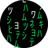

<p align="center">
  
</p>

<h1 align="center">RW4 - CMatrix</h1>

<p align="center">
  
  
  
  
</p>

<p align="center">A faithful <b>CMatrix</b> clone — the classic "matrix digital rain" — on the Redmi Watch 4's true-black AMOLED screen.</p>
<p align="center">One screen, green glyphs falling in columns, no clock, no date, no permissions.</p>

<p align="center">A minimal Xiaomi Vela JS quick app (<code>.rpk</code>) built on the <a href="https://github.com/hyperpostulate/rw4-poc"><b>rw4-poc</b></a> boilerplate — the platform PoC that mapped what a third-party Vela quick app can and cannot do on this device.</p>

<p align="center">Inspired by <b>cmatrix</b> by Chris Allegretta (current upstream: <a href="https://github.com/abishekvashok/cmatrix">github.com/abishekvashok/cmatrix</a>).</p>

<p align="center">Türkçe sürüm: <a href="README-TR.md">README-TR.md</a></p>

* * *

## Table of Contents

- [What this is](#what-this-is)
- [What it shows](#what-it-shows)
- [Install on the Watch](#install-on-the-watch)
- [Build & Run](#build--run)
- [Project Structure](#project-structure)
- [On-device findings](#on-device-findings)
- [Limitations](#limitations)
- [License](#license)
- [Developer](#developer)
- [Contributing](#contributing)

* * *

## What this is

A deliberately tiny app that does one thing well: it recreates cmatrix's falling-character rain on the Redmi Watch 4. It is a pure visual toy — there is no clock face, no sensor input, no network, and no permission request. Under the hood it is also a working demonstration of what a third-party Vela quick app can do on this device.

To build your own app on top of the boilerplate, see the upstream guide: **[rw4-poc → docs/developing.md](https://github.com/hyperpostulate/rw4-poc/blob/main/docs/developing.md)**.

## What it shows

One screen — true black, two shades of green — covered by a fixed grid of **16 columns × 17 rows = 272 cells** (24×26 px each). Each column is an independent trail of glyphs:

| Property | Behaviour |
| :-- | :-- |
| **Speed** | 0.2–0.4 cells per tick, with a fractional accumulator per column |
| **Trail** | 6–14 cells long, brightest at the head and fading down the tail |
| **Respawn** | A column that leaves the screen idles 0–25 ticks, then starts again |
| **Mutation** | On each tick an active column has a 5% chance to re-roll one visible glyph (cmatrix's flickering-character effect) |
| **Glyphs** | 70% halfwidth katakana / 30% Latin letters, digits and symbols |

Two brightness shades are used: a white-ish green head `(208,255,224)` and the body green `(0,200,83)`. The animation ticks every 500 ms; on-device the screen steps about every 0.8 s (the measured hardware floor for this grid — see [Limitations](#limitations)).

No permission is requested: the app only uses a JS timer.

* * *

## Install on the Watch

The `.rpk` is installed over Bluetooth from an Android phone using the **[Notify for Xiaomi](https://play.google.com/store/apps/details?id=com.mc.xiaomi1)** app (Google Play listing "Notify for Xiaomi/Mi Band 8-10", package `com.mc.xiaomi1`, by OneZeroBit). The Redmi Watch 4 is on the app's official compatibility list, and the app's official site documents installing custom VelaJS (`.rpk`) apps this way.

> **Verification status:** verified on a real Redmi Watch 4 — the app installs and runs correctly with this method.

### Prerequisites

- An **Android phone** (iOS cannot install `.rpk` files).
- **Notify for Xiaomi** installed from Google Play.
- The watch paired with Notify: the in-app setup wizard fetches the pairing (auth) key through your Xiaomi account, so Mi Fitness does not need to stay installed.
- Only one app can hold the watch's Bluetooth connection at a time. If Mi Fitness is installed, force-stop it, deny its "Nearby devices" permission, or uninstall it — but **do not un-pair the watch from Mi Fitness before uninstalling**.

### Steps

1. Build the package: `npm run build` → `dist/com.hyperpostulate.rw4cmatrix.debug.<version>.rpk`.
2. Open **Notify for Xiaomi**.
3. Go to **Device**.
4. Select **Third party app**.
5. Select the `.rpk` file (`dist/com.hyperpostulate.rw4cmatrix.debug.<version>.rpk`).
6. Keep the watch near the phone and follow the guided steps.
7. When the installation finishes, **RW4 - CMatrix** appears in the watch's app list.

### Notes

- The debug-signed `.rpk` produced by `npm run build` is fine for this app: Vela only checks the certificate for watch↔phone Interconnect communication, which this app does not use.
- Redmi Watch 4 limits: at most ~20 quick apps installed, and ~87 MB of free space is required for quick-app installs.
- To update, build a new `.rpk` and install it over the same package name (`com.hyperpostulate.rw4cmatrix`). Changing the `package` value installs a **separate** app instead of updating.
- Unverified details: the app version that introduced `.rpk` installs, and whether the feature requires the (about €3, one-time) PRO purchase, are not officially documented. The menu labels above are the English ones; the app itself is localized, but the Turkish labels were not verified.

Sources: [Notify for Xiaomi VelaJS install guide](https://mibandnotify.com/xiaomi-mi-band/notify-xms-app-instructions.php) · [Google Play listing](https://play.google.com/store/apps/details?id=com.mc.xiaomi1)

* * *

## Build & Run

Requirements:

| Requirement | Version / Notes |
| :-- | :-- |
| Node.js | 18+ (tested on v24.12.0) |
| npm | 9+ (tested on 11.6.2) |
| Python 3 + Pillow | Only needed to regenerate the PNG assets (`scripts/gen_assets.py`) |
| Android phone | Only needed to install the `.rpk` onto the watch via **Notify for Xiaomi** (see [Install on the Watch](#install-on-the-watch)) |
| `aiot-toolkit` | Pulled in automatically as a dev dependency (`npm install`) |

```
git clone https://github.com/hyperpostulate/rw4-cmatrix.git
cd rw4-cmatrix
npm install                          # Install the aiot-toolkit toolchain
npm run build                        # Build a debug .rpk into dist/
npm run release                      # Build a release .rpk (requires signing keys)
npm run start                        # aiot start --watch (live development)
python3 scripts/gen_assets.py        # Regenerate the PNG assets from code
```

The toolchain is `aiot-toolkit`. Every glyph asset is generated at exactly the size it is displayed at, which keeps the bundle small (the toolkit's `--enable-image-png8` flag actually makes the bundle *larger* at this asset size, so it is not used). The build produces `dist/com.hyperpostulate.rw4cmatrix.debug.<version>.rpk` — about **135 KB**, of which the 199 PNGs in `src/common/txt/` account for roughly 75 KB. The debug `.rpk` needs no signing; a release package needs `sign/private.pem` and `sign/certificate.pem` (generate with OpenSSL).

On-device verification checklist:

1. Is the rain drawn as glyph trails (not empty or solid blocks)?
2. Do columns fall at different speeds, pause, and restart?
3. Are both shades visible (bright head and green body)?
4. Does an occasional glyph mutation show up?
5. Does the screen step roughly every 0.8 s? That is the measured hardware floor for this 272-image grid — the renderer is already incremental (one update event per changed column); going faster would require a smaller grid, which visibly thins the rain.
6. In the launcher, are the icon and the app name in their normal positions?

* * *

## Project Structure

```
rw4-cmatrix/
├── src/
│   ├── manifest.json          # package com.hyperpostulate.rw4cmatrix, name "RW4 - CMatrix", designWidth 390
│   ├── app.ux                 # app entry (onCreate/onDestroy)
│   ├── common/
│   │   ├── logo.png           # launcher icon: matrix rain motif, 96x96 (see On-device findings: icon size moves the app name)
│   │   └── txt/               # generated glyph atlas: g_<hex>_<shade>.png (99 chars x 2 shades) + blank.png
│   └── pages/
│       └── index/
│           └── index.ux       # the whole app: column-major 16x17 grid + incremental splice renderer + rain logic + TUNING constants
├── scripts/
│   ├── gen_assets.py          # reproducible Pillow generator for every PNG asset
│   └── assets/
│       ├── ui-subset.ttf      # Latin glyph font, generation time only (not shipped)
│       └── katakana-subset.ttf # katakana glyph font, generation time only (OFL; not shipped)
├── docs/
│   └── design.md              # UI/UX design specification (Turkish)
├── dist/                      # build output (.rpk) - gitignored
├── build/                     # intermediate build output - gitignored
├── package.json
├── LICENSE                   # GPLv3 full text
├── README.md
└── README-TR.md              # Turkish version
```

### Core Files

| File | Purpose |
| :-- | :-- |
| `src/manifest.json` | Vela app manifest: `package` = `com.hyperpostulate.rw4cmatrix`, `name` = `RW4 - CMatrix`, `deviceTypeList: ["watch"]`, `designWidth: 390`, `features: ["system.router"]` (the app uses no other system API) |
| `src/pages/index/index.ux` | The whole app: column-major grid template (272 `<image>` cells), incremental renderer (one full-range splice per changed column), rain simulation (speeds, trails, respawn, mutation, shade mapping) and styles, plus the `TUNING` constants |
| `scripts/gen_assets.py` | Generates the two-shade glyph atlas (198 files), `blank.png` and the launcher icon (a 96x96 matrix-rain motif) deterministically; re-reads every file it writes and asserts dimensions (and non-blank ink for glyphs) |
| `docs/design.md` | The authoritative UI/UX spec (palette, geometry, animation model, asset spec) |

* * *

## On-device findings

Verified on a **real Redmi Watch 4**. Full detail — including the complete system-API table — is in the boilerplate repo: **[rw4-poc → docs/findings.md](https://github.com/hyperpostulate/rw4-poc/blob/main/docs/findings.md)**.

- **Text does not render.** `<text>`/`<span>`/`<input>` paint no readable glyphs and a bundled `@font-face` has no effect, so every visible character is a pre-rendered PNG. This app composes the rain from a per-character glyph atlas: 99 characters × 2 shades = 198 files plus `blank.png`.
- **Which system APIs work.** `@system.device`, `@system.storage`, `@system.brightness`, `@system.app`, `vibrator.vibrate()` and the JS clock work; geolocation (GPS, error `203`), sensor, battery, network, bluetooth, record, fetch and crypto do not.
- **No GNSS or health API** is exposed to quick apps, so a GPS/location quick app is impossible on this device. This app needs neither.
- **`203`** is Vela's *"function not supported"* code (a permission problem would be `400`/`402`); it is not recoverable by the app.
- **Launcher icon size moves the app name.** The launcher reserves a slot whose width follows the icon PNG's pixel size, so the icon also sets where the label starts — and no manifest field controls label position. The **96x96** `logo.png` is deliberate: `192x192` pushed the app name to the middle of the row, while `96x96` kept it in its normal position.
- **`<canvas>` crashes the device.** The canvas JS API surface exists (`$element` → `getContext('2d')` → `fillRect`/`drawImage`, plus a global `Image`), but it paints nothing and using it crashed the quick app runtime hard enough to **reboot the watch**. Do not build a canvas renderer for this device — full finding in the upstream `docs/findings.md`.
- **Image-grid update cost model.** The framework re-renders a `for` list per observed array mutation (~0.1 s per touched list on this device); the changed-cell count is secondary, and assigning a fresh array reference re-sets the whole list. This app's renderer is tuned around that model (stable column-major arrays, one full-range `splice` per changed column).

* * *

## Limitations

- **Text must be images.** Adding new characters means extending the character pools in `scripts/gen_assets.py` (`LATIN` / the katakana range) and regenerating the atlas. Characters outside the atlas would not have a matching `g_<hex>_<shade>.png`.
- **The rendering cost floor is reached.** 272 `<image>` cells updated with incremental, column-major splices step the screen about every **0.8 s** on-device, after five measured renderer iterations (full data reassignment ~7–8 s → per-cell splices ~3–4 s → per-row splice ~2 s → column-major ~1 s → current ~0.8 s). Going faster would require a smaller grid, which visibly thins the rain — deliberately not taken.
- **The grid is fixed at runtime.** The data arrays are column-major and stable: each tick patches only the columns that changed, with one full-range `splice` per column; no nodes are created or destroyed. Resizing the grid means editing the `TUNING` constants, the CSS geometry and regenerating the atlas.
- **Canvas is not an alternative.** A single-surface canvas renderer was probed on-device: the JS API exists but paints nothing and crashed the runtime so hard the watch rebooted (see [On-device findings](#on-device-findings)). Do not retry.
- **`npm audit` reports vulnerabilities in transitive dev dependencies** of `aiot-toolkit`. They are build-time only and do not ship inside the `.rpk`.

* * *

## License

This project is licensed under the **GNU General Public License v3.0 (GPL-3.0)** — see the [LICENSE](LICENSE) file for the full license text.

* * *

## Developer

**Mesut ORMANLI**

- Email: [mesutormanli@gmail.com](mailto:mesutormanli@gmail.com)
- GitHub: [@hyperpostulate](https://github.com/hyperpostulate)

* * *

## Contributing

1. Fork the repository
2. Create a feature branch (`git checkout -b feature/new-feature`)
3. Commit your changes (`git commit -m 'Add new feature'`)
4. Push to the branch (`git push origin feature/new-feature`)
5. Create a Pull Request

* * *
